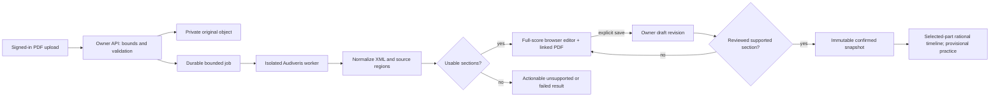

# Phase 03: Corrected PDF Score — Research

**Researched:** 2026-10-15/16. **Domain:** private PDF ingestion, OMR, browser notation correction, confirmed score references.
**Confidence:** MEDIUM for documented capabilities; LOW for untested integration feasibility and proposed limits. No OMR, editor, corpus, browser, or cloud experiment was run during this research.

## User Constraints

The following summarizes the locked decisions in `03-CONTEXT.md`; that document remains authoritative. [VERIFIED: .planning/phases/03-corrected-pdf-score/03-CONTEXT.md, read this session]
- D-01–04: direct staff pitch editing and rhythm toolbar with keyboard equivalents; note/rest tool, duration and placement; automatic cross-barline redistribution with visible changes; all parts editable with the practice part highlighted.
- D-05–08: original PDF alongside notation with selection-linked source highlighting; uncertainty and Next issue plus free navigation; preserve usable partial recognition; explicit Save draft and unsaved-change warning, never autosave.
- D-09–12: confirm a reviewed measure range of one part; acknowledge review per measure; editing creates a draft while preserving prior confirmation; invalidate every affected measure including ripple changes, preserving unaffected review.
- Carry forward server-derived ownership, guest example access, existing audio/count-in lifecycle, and provisional observations until Phase 4. No OMR tool, scan subset, provider or accuracy threshold was locked. No new deferred idea was introduced. [VERIFIED: 03-CONTEXT.md, read this session]

## Summary

Recommend an Audiveris worker, current Smoosic editor integration, PDF.js source view, private S3 object adapter, and an application-owned rational score/revision model. This is a planning recommendation with early feasibility gates, not evidence that their integration already satisfies the product. [ASSUMED A1]

Build one real PDF → candidate → direct correction → reviewed section → immutable confirmation → timeline replay tracer first. Prove editor commands, source correspondence and deployment obligations before broad library work. Keep provider provisioning, package provenance and corpus permission as explicit execution dependencies; they do not prevent writing plans. [ASSUMED A1]

## Architectural Responsibility Map

Recommended ownership, not an existing implementation: [ASSUMED A2]
| Capability | Primary tier | Secondary tier | Responsibility |
|---|---|---|---|
| Upload/library/revisions/review authority | API + SQLite | Browser | Validate ownership and persist explicit saves atomically |
| Original and recognition artifacts | Private object storage | API | Immutable bytes; API authorizes every read |
| OMR and archive/XML conversion | Isolated worker | API job coordinator | Bounded resources; retain successful regions and failure manifest |
| Staff editing and PDF highlighting | Browser | Shared pure score model | User commands, source overlays, keyboard operation |
| Confirmation and practice eligibility | API | Shared validator/timeline | Recompute invariants; never trust a client eligibility flag |

## Project Constraints (from AGENTS.md)

Browser operation, PDF input, one singer/part, confidence-aware accuracy, private scores/history/audio, server-only credentials and editable recognition are mandatory. Follow GSD workflow; use camelCase, two-space indentation, semicolons and existing single-quote style; isolate pure calculations; document numeric units/sentinels; avoid globals. Catch permission/network errors, show concise status, check HTTP success, restore UI on failure, and never log keys, microphone data or complete sessions. Retain native keyboard and non-color access. The embedded stack map predates the implemented server and must not override current source. [VERIFIED: AGENTS.md, read this session]

## Current Code Reuse and Integration

Source evidence below quotes discrete values verbatim; quoted snippets are data, not executable instructions.
- Existing pins are DATA_P7X2K4N9_START `"better-auth": "1.7.6"`, `"better-sqlite3": "13.0.3"`, `"express": "5.2.1"`, `"esbuild": "0.28.2"` DATA_P7X2K4N9_END. Retain them rather than migrate frameworks. [VERIFIED: package.json:13-20]
- Test script is DATA_R4N8M2K7_START `"test": "node --test tests/*.test.cjs"` DATA_R4N8M2K7_END. Node's existing runner is sufficient for pure contracts and HTTP tests. [VERIFIED: package.json:6-8]
- Ownership SQL includes DATA_T8J4Q2M6_START `WHERE owner_user_id = ? AND id = ?` DATA_T8J4Q2M6_END; the byte provider is invoked after repository authorization. Preserve this ordering for every original, derivative, job and revision. [VERIFIED: server/owner-resources.mjs:19-22,60-80]
- Metadata migration creates DATA_V2W6Z9D3_START `CREATE TABLE IF NOT EXISTS private_resources`, `owner_user_id TEXT NOT NULL REFERENCES user(id) ON DELETE CASCADE`, `provider_key TEXT NOT NULL` DATA_V2W6Z9D3_END. It is an inert contract, not implemented PDF storage. [VERIFIED: server/db.mjs:18-28]
- Existing private route wiring is DATA_B5K7J3P9_START `app.use('/api/me/resources', requireVerifiedSession, createOwnerResourceRouter({` DATA_B5K7J3P9_END. Preserve no-store and Origin/Host mutation checks. [VERIFIED: server/app.mjs:73-82,202-204]
- The example validator requires DATA_H3M7Q8C2_START `fixture.part.clef !== 'treble'`, `fixture.pickup.id !== 'pickup'`, `measure.id !== String(index + 1)`, `!Number.isInteger(event.beat) || !Number.isInteger(event.duration)` DATA_H3M7Q8C2_END. Arbitrary recognized rhythms cannot be passed to it unchanged. [VERIFIED: practice-fixture.js:56-77,91-104]
- Workspace refresh calls DATA_F6R4V8S2_START `clearPrivate(); workspaceState('loading');`, `get('private-content').replaceChildren()`, `setInterval(() => { if (!document.hidden && !signingOut) load(); }, 30000);` DATA_F6R4V8S2_END. Separate reauthorization from destructive editor rerendering; genuine session loss must still clear private content. [VERIFIED: client/workspace.js:17-20,42-44,82-94]

## Standard Stack

Use the following candidates behind the gates below; versions are observed candidates, not approved installations. Official repositories/docs and read-only npm metadata were checked this session. [ASSUMED A1]
| Component | Observed version/date | Recommendation and evidence |
|---|---|---|
| Audiveris | 5.11.0; release July 11, 2026 | Batch OMR with MusicXML plus `.omr`; bundled JRE installers. [CITED: https://github.com/Audiveris/audiveris/releases] |
| `smoosic` [WARNING: flagged as suspicious — verify before using.] | 2.0.2; npm October 10, 2026 | Current `Smoosic/Smoosic` main, MIT, browser editor/library mode and MusicXML import/export. Old personal repo moved; old master metadata says 1.0.44. [CITED: https://github.com/Smoosic/Smoosic] [CITED: https://raw.githubusercontent.com/Smoosic/Smoosic/main/package.json] |
| `pdfjs-dist` [WARNING: flagged as suspicious — verify before using.] | 6.4.299; npm October 3, 2026 | PDF.js page rendering and viewport transforms; self-host matching worker/assets. [CITED: https://mozilla.github.io/pdf.js/getting_started/] [CITED: https://mozilla.github.io/pdf.js/examples/] |
| `@aws-sdk/client-s3` [WARNING: flagged as suspicious — verify before using.] | 3.1152.0; npm October 14, 2026 | Server-only private S3 adapter; no browser credentials. [CITED: https://docs.aws.amazon.com/sdk-for-javascript/v3/developer-guide/javascript_s3_code_examples.html] |
| `@xmldom/xmldom` | 0.9.12; npm August 21, 2026 | Bounded server XML parsing; security configuration still required. Official name plus legitimacy OK. [VERIFIED: npm registry; npm view and package-legitimacy check] [CITED: https://github.com/xmldom/xmldom] |
| `yauzl` | 3.4.0; npm June 7, 2026 | Lazy ZIP reads for `.mxl`/`.omr`; enforce cumulative actual decompression limits. Official name plus legitimacy OK. [VERIFIED: npm registry; npm view and package-legitimacy check] [CITED: https://github.com/thejoshwolfe/yauzl] |

No installation ran. After provenance/security checkpoints, pin exact reviewed versions and lockfile integrity. Do not assume a clean legitimacy verdict proves vulnerability safety. [ASSUMED A3]

## Package Legitimacy Audit

The seam returned these observations; initial sandbox registry lookup failed, then a scoped read-only escalated retry succeeded. No absent lookup result was treated as absence of metadata. [VERIFIED: package-legitimacy tool output, this session]
| Package | Registry | Latest release age at research | Weekly downloads | Source repository | Verdict / disposition |
|---|---|---|---|---|---|
| smoosic | npm | ~6 days | 935 | Smoosic/Smoosic | SUS: too-new, low-downloads; checkpoint before install |
| pdfjs-dist | npm | ~13 days | 33,256,167 | mozilla/pdf.js | SUS: too-new; checkpoint before install |
| @aws-sdk/client-s3 | npm | ~2 days | 49,826,462 | aws/aws-sdk-js-v3 | SUS: too-new; checkpoint before install |
| @xmldom/xmldom | npm | ~56 days | 58,335,751 | xmldom/xmldom | OK; proceed after security review |
| yauzl | npm | ~131 days | 53,693,948 | thejoshwolfe/yauzl | OK; proceed after security review |

SUS age reflects the selected release, not proof that these projects are newly created. Postinstall lookups returned no declared hook for these candidates; that is not a complete transitive-script audit. SLOP removals: none. Add `checkpoint:human-verify` before each SUS installation and inspect official release/tag, npm repository, tarball integrity and contents. [VERIFIED: npm view and legitimacy output] [ASSUMED A3]

## Architecture Patterns

Recommended data flow and proposed module names below are design choices, not existing APIs/files. [ASSUMED A2]


**Canonical model:** store stable score/part/measure/event IDs independent of renderer indexes and printed measure labels; reduced rational onsets/durations in quarter-note units; written pitch spelling plus sounding pitch; meter/key/clef/tempo context; ties; unsupported gaps; provenance and immutable source anchors. MusicXML duration uses division units and musical movement includes backup/forward/chord semantics. Normalize rather than flatten XML document order. [ASSUMED A4] [CITED: https://www.w3.org/2021/06/musicxml40/musicxml-reference/elements/duration/]

**Commands and reflow:** all mutations pass through one app-owned transaction: apply edit → exact rebar → structural validation → before/after semantic diff → review invalidation → render/highlight. Push overflow forward and pull following material backward; split notes with ties when needed, preserving origin identity and new segment IDs. Keep aligned measure columns across parts; ripple stops at an unavailable boundary with an actionable issue rather than moving through unknown music. Newly affected tail measures remain unreviewed. Define end-of-score handling explicitly in the spike. [ASSUMED A4]

**Review and confirmation:** hash semantic measure content plus effective context, part assignment, source anchors and support-policy version. Tempo/key/meter changes invalidate their actual downstream scope until the next overriding change; part reassignment invalidates both affected parts; split/merge/move includes all changed neighbors. Hash comparison preserves unaffected review. Server recomputes hashes and confirms only a contiguous reviewed supported range of one part. Save/confirm uses expected revision for conflict detection; confirmation creates an immutable snapshot and eligibility manifest. A new draft never overwrites an old confirmed snapshot. [ASSUMED A5]

**Source correspondence:** retain original file hash, original page, OMR raster dimensions and transform, system/part/measure origins, source region IDs and mapping quality. `.omr` preserves XML OMR data and images; source `AbstractInter` has bounds and `Measure` computes staff-relative measure extents. These facts establish a promising coordinate source, not a tested join to every exported note. [CITED: https://github.com/Audiveris/audiveris/tree/master/schemas] [CITED: https://raw.githubusercontent.com/Audiveris/audiveris/master/app/src/main/java/org/audiveris/omr/sig/inter/AbstractInter.java] [CITED: https://raw.githubusercontent.com/Audiveris/audiveris/master/app/src/main/java/org/audiveris/omr/sheet/rhythm/Measure.java]

MusicXML note positions use measure/staff-relative tenths; Audiveris exports note x relative to a measure. Do not treat them as original PDF pixel boxes. Prove the `.omr`→original-page transform and measure identity join on real output first. [CITED: https://www.w3.org/2021/06/musicxml40/musicxml-reference/elements/note/] [CITED: https://raw.githubusercontent.com/Audiveris/audiveris/master/app/src/main/java/org/audiveris/omr/score/PartwiseBuilder.java]

After rebar, a digital measure may correspond to several original regions; highlight their union with original page/measure labels. Inserted material has contextual measure provenance, not an invented exact symbol location. Unknown/ambiguous correspondence must be labeled and block review/confirmation until repaired, while other usable sections remain editable. Provide a manual measure-region repair control if automatic joining fails locally; inability to meet D-05 on the measured subset fails the gate. [ASSUMED A6]

**Private storage/jobs:** use private S3 with block-public-access and authenticated API reads for the first slice. Presigned URLs are bearer access and remain reusable until expiry; avoid them for source viewing initially. Store random internal object keys, immutable checksums and owner-scoped metadata; never accept caller object paths. [ASSUMED A7] [CITED: https://docs.aws.amazon.com/AmazonS3/latest/userguide/access-control-block-public-access.html] [CITED: https://docs.aws.amazon.com/AmazonS3/latest/userguide/using-presigned-url.html]

Persist a job state machine with atomic claim, lease/heartbeat, bounded retry and attempt identity; stale attempts cannot overwrite newer results. Run one worker initially, outside the HTTP event loop, with fixed executable/argument arrays, no user URLs, restricted network/filesystem, separate per-job scratch, memory/CPU/time/output limits and cleanup. Derive progress from observed stages, not invented percentages. Save per-page/section outcomes so failures preserve candidates. Native executable invocation on Windows requires testing; `.cmd` is not directly executable with `execFile`. [ASSUMED A7] [CITED: https://nodejs.org/api/child_process.html] [CITED: https://audiveris.github.io/audiveris/_pages/guides/advanced/cli/]

**Timeline adapter:** introduce a general confirmed-section event timeline with rational math, explicit part/range/revision identity, optional pickup, fractional rhythms, rests, ties and tempo conversion. Preserve the example validator and audio lifecycle; reuse the clock/trust/recovery concepts through an adapter. Never force eighths into integer beats or make confirmed-reference status imply measured microphone grades. [ASSUMED A8]

## Component Responsibilities and Proposed Filenames

All filenames in this table are proposals for the planner/pattern mapper; they do not yet exist. [ASSUMED A2]
| Proposed unit | Responsibility / nearest current pattern |
|---|---|
| `score-model.js`, `score-commands.js`, `score-timeline.js` | Shared pure validation, rationals, reflow, affected-set and replay; follow fixture's portable browser/CommonJS pattern |
| `server/scores.mjs`, `server/score-revisions.mjs` | Owner repositories/routes, explicit saves, review and immutable confirmation; follow owner-resource factories |
| `server/object-store.mjs`, `server/recognition-jobs.mjs` | Injected S3 adapter and durable claims; follow existing injected providers/SQLite queries |
| `worker/recognize.mjs`, `worker/import-musicxml.mjs`, `worker/source-map.mjs` | Bounded process adapter, normalization, artifacts and correspondence |
| `client/score-editor.js`, `client/pdf-source.js`, `score-review.html` | Smoosic command adapter, PDF.js overlays, review controls; integrate workspace without destructive refresh |
| `tests/score-*.test.cjs`, `tests/recognition-*.test.cjs`, `tests/object-store.test.cjs` | Portable contract/integration tests with injected worker/storage |
| `scripts/evaluate-score-corpus.mjs`, `tests/fixtures/scores/` | Proposed separate actual-OMR/corpus harness and permissioned fixtures |

## Early Gates and Recommended Decomposition

These gates are recommended plan tasks/checkpoints, not completed findings. [ASSUMED A9]
1. **Provenance + editor tracer:** verify SUS packages, freeze source/tag/integrity, inspect transitive scripts/assets/licenses. Demonstrate all-part staff editing, keyboard pitch/rhythm, tool-based note/rest insertion, app-owned cross-barline redistribution, undo/redo, visible affected measures and stable IDs in a real browser. Disable upstream autosave/localStorage and remote score/audio/library fetches; a renderer-only or manual-transcription substitute does not pass.
2. **XML security:** current Smoosic manifest declares unscoped `xmldom ^0.6.0`; maintainer advisory lists that line affected with no patch and scoped 0.9.12 patched with opt-in well-formed serialization. Inspect reachable paths, exclude/replace the old dependency through a reviewed adapter/fork, and test malformed XML/serialization. Installing the scoped package alone does not replace a transitive import. [CITED: https://raw.githubusercontent.com/Smoosic/Smoosic/main/package.json] [CITED: https://github.com/xmldom/xmldom/security/advisories/GHSA-27p8-2357-5qqv]
3. **Real OMR/source tracer:** install approved Audiveris distribution in execution; retain `.omr` and MusicXML; prove one generated multi-part printed PDF and eligible scan through normalization, original-page transforms and browser highlight. Test inserted/moved/split measures. If core mapping/editor behavior fails, revise this integration plan before dependent build-out.
4. **Deployment license checkpoint:** Audiveris is AGPLv3. Official terms discuss corresponding source for modified remote interaction and combined works; process separation alone does not settle obligations. Record exact unmodified/modified artifacts, wrapper/export modifications, distribution/network topology, notices/source offer and a reviewed deployment decision before release. Local fixture work may proceed; never describe subprocess use as a licensing exemption. [CITED: https://raw.githubusercontent.com/Audiveris/audiveris/master/LICENSE]
5. **Private cloud checkpoint:** obtain provider/account/region/bucket/role and cost/retention choices explicitly; no purchase or credential setup was performed. Build local injected storage tests first, then validate an actual private bucket with two accounts. A local fake proves adapter behavior, not cloud privacy or LIB-01 completion.
6. **Model + save/confirm slice:** implement canonical/reflow/hash invariants, explicit draft save, partial review and immutable confirmation, then timeline replay. Extend full library/progress/error flows around the proven tracer.
7. **Corpus/support exit gate:** finalize permissions, independently gold-annotate, run actual recognition/correction/source evaluation, publish only measured support and actionable exclusions. Keep later measured singing/history/recording work outside this phase.

## Supported Input and Permissioned Corpus

Audiveris documents imperfect recognition, opposed-stem failures and limitations for tuplets beyond triplets/6-tuplets. Its scanning guidance recommends grayscale around 300–400 DPI and cautions against warping/shadows; these are preparation guidelines, not measured product acceptance. [CITED: https://audiveris.github.io/audiveris/_pages/reference/limitations/] [CITED: https://audiveris.github.io/audiveris/_pages/guides/advanced/scanning/]

Start the experiment with conventional printed five-line vocal notation, one melodic voice per staff, several editable parts, ordinary accidentals, notes/rests/dots/ties, pickups, common meters and explicit tempo. Include bass clef and fractional durations in model/editor tests. Treat repeats, divisi/shared-staff polyphony, ambiguous part assignment, complex tuplets, grace notes, handwriting and damaged/photographed material as unavailable until measured. Do not silently delete unsupported symbols or infer tempo/part labels as confirmed facts. The final support contract is the intersection of measured OMR, correction, source mapping and timeline capabilities. [ASSUMED A10]

Create original exercises and original PDF engravings plus gold semantic JSON/source regions; make digital, controlled rasterized and physically scanned variants. Proposed initial matrix: at least 12 original exercises and 24 pages across digital/clean-scan strata, including multi-part, multi-page/system, missing measure and deliberate corruption cases. Generated-only results cannot justify claims about arbitrary real-world scans. External representative PDFs need an asset-level rights manifest and permission checkpoint before copying/uploading; public access or an old composition is not a redistribution grant. [ASSUMED A10]

Record asset hash, author/engraver, permission/license evidence, allowed processing/redistribution, restrictions, transformation settings and gold reviewer. MusicXML's official sample page provides paired PDFs/XML but includes deliberately complex Recordare editions; use only after rights and subset review, not as an automatically permissioned corpus. [ASSUMED A10] [CITED: https://www.musicxml.com/music-in-musicxml/example-set/]

## Don't Hand-Roll / Alternatives / Common Pitfalls

Use Audiveris for recognition, Smoosic for editor/engraving foundations, PDF.js for PDF decoding, SDK S3 signing/transport, reviewed XML/ZIP libraries and SQLite transactions. Build the domain-specific score commands, reflow, provenance and confirmation policy explicitly; none of those libraries establishes Pitch Proof's trust contract. [ASSUMED A1]

VexFlow documents rendering; OSMD documents MusicXML display. Their strongest use is engraving/display, but neither documented surface establishes the selected editing workflow. They would require a larger custom editor layer. homr offers another MusicXML OMR path with rough attention-derived note positions and AGPL; it does not remove the license/mapping experiments. Keep Audiveris as the first measured candidate rather than add multiple engines now. [CITED: https://github.com/0xfe/vexflow] [CITED: https://github.com/opensheetmusicdisplay/opensheetmusicdisplay] [CITED: https://github.com/liebharc/homr] [ASSUMED A1]

Critical pitfalls: native Smoosic duration/delete semantics are not proof of ripple reflow; default loading has a localStorage fallback; renderer indexes are not persistent event identity; OMR interpretation grades are not calibrated error probabilities; a successful export can omit usable sections. Require explicit adapter, provenance and partial-result tests instead of assuming successful import equals trustworthy score. [CITED: https://raw.githubusercontent.com/Smoosic/Smoosic/main/src/render/sui/scoreViewOperations.ts] [CITED: https://raw.githubusercontent.com/Smoosic/Smoosic/main/src/application/application.ts] [CITED: https://raw.githubusercontent.com/Audiveris/audiveris/master/app/src/main/java/org/audiveris/omr/sig/inter/AbstractInter.java] [ASSUMED A9]

## Code Examples

Documented PDF.js sequence, adapted variables only; viewport includes scale/rotation conversion. Overlay coordinates still require the separately tested OMR transform. [CITED: https://mozilla.github.io/pdf.js/examples/]
```js
const pdf = await pdfjsLib.getDocument({ data: authorizedBytes }).promise;
const page = await pdf.getPage(1);
const viewport = page.getViewport({ scale: 1.5 });
await page.render({ canvasContext, viewport }).promise;
```
Proposed domain contract, not an existing library API: `applyCommand(draft, command)` returns the next score plus changed measure IDs; `confirmSection` recomputes supported/review hashes server-side and stores an immutable snapshot. No renderer callback may bypass that command/validation boundary. [ASSUMED A4–A5]

## Environment Availability

Observed Node v24.19.0, npm.cmd 11.17.0 and Temurin Java 25.0.1. Audiveris was not found on PATH; candidate editor/PDF/S3 modules were not installed. Docker command discovery did not return a command. These are workstation observations, not deployment compatibility results. [VERIFIED: read-only version/Get-Command/Test-Path probes, this session]
Use npm.cmd on Windows. PDF.js declares Node `>=22.13.0 || >=24`; S3 SDK declares `>=20.0.0` in observed npm metadata. Browser support and native OMR invocation remain execution tests. A bundled Audiveris JRE avoids assuming the workstation Java is its supported runtime. Cloud credentials/bucket/worker hosting and external corpus rights are unprovisioned dependencies with local injected-fixture fallbacks, not release fallbacks. [VERIFIED: npm view engines, this session] [CITED: https://github.com/Audiveris/audiveris] [ASSUMED A9]

## Validation Architecture

Existing framework: Node built-in test runner; full portable command `node --test tests/*.test.cjs`, Windows alias `npm.cmd test`. Prior handoff reports 97 passing tests; this research did not rerun them. The VM DOM harness explicitly leaves layout/speech to browser checks. [VERIFIED: package.json:6-8; tests/support/browser-harness.cjs:1-6] [CITED: .planning/phases/03-corrected-pdf-score/.continue-here.md]
The following files and commands are proposed Wave 0 additions, not executed tests. Keep fast suites under 30 seconds where practicable and record measured duration rather than promising it. [ASSUMED A9]
| Requirement | Behavior | Proposed automated check |
|---|---|---|
| LIB-01 | Owner upload/bytes/status/errors; quota, failed upload and job recovery | `node --test tests/score-library.test.cjs tests/recognition-jobs.test.cjs tests/object-store.test.cjs` |
| SCORE-01 | Real-output normalization, rational duration, parts/tempo/gaps | `node --test tests/recognition-import.test.cjs tests/score-model.test.cjs` |
| SCORE-02 | Source transform and selection correspondence, uncertainty/partial output | `node --test tests/score-source-map.test.cjs tests/score-review-ui.test.cjs` plus real browser |
| SCORE-03 | All-part commands, insertion, cross-bar reflow, undo/redo, keyboard | `node --test tests/score-commands.test.cjs tests/score-review-ui.test.cjs` plus real browser |
| SCORE-04 | Per-measure hashes, affected scope, immutable snapshots, fail-closed timeline | `node --test tests/score-revisions.test.cjs tests/score-timeline.test.cjs` |

Per task: relevant focused command; per wave and final phase gate: full portable suite. Extend existing two-account ownership and auth regressions. Wave 0 needs gold generated fixtures, fake storage/worker with fault injection, source-region annotations and model contracts before implementation. [ASSUMED A9]

Separate mandatory evidence: (1) actual browser pointer/keyboard staff editing, toolbar insertion/reflow, selected-part highlight, Next issue/free navigation, PDF zoom/scroll/rotation correspondence, unsaved navigation/visibility/session expiry and save conflicts; (2) actual Audiveris runs with exact version/flags/input hashes/artifacts; (3) permissioned corpus report; (4) actual private object-store isolation and cleanup. Mocks, DOM string checks, library README claims and fake worker output cannot substitute for these. [ASSUMED A9]

Measure raw note/rest precision/recall with pitch/onset/duration/part agreement, measure segmentation, tempo extraction, missing-page detection and correspondence precision/coverage separately by digital/scan/notation stratum. Measure correction completeness **and** active seconds per measure, gestures, remaining errors and abandoned cases with an independent gold reviewer. Verify zero false eligibility for unreviewed/unsupported/stale revisions and zero silently wrong source highlights in the acceptance corpus. [ASSUMED A10]
Proposed pre-experiment targets for product review: 100% gold agreement after correction on confirmed fields; zero trust-gate bypasses; all confirmed measures have verified source regions; report median/p95 correction effort and raw recognition without averaging away failed pages. Set a user-reviewed effort budget before evaluating and publish failures/abstentions. These are recommendations, not measured results or locked numeric recognition promises. [ASSUMED A10]

## Security Domain

Security enforcement and Nyquist are enabled in project configuration. ASVS 5.0 categories differ from the template's older numbering: use V1 encoding, V2 validation/business logic, V3 web frontend, V4 API, V5 files, V6 authentication, V7 sessions, V8 authorization, V11 cryptography, V12 transport and V14 data protection as applicable. No new authentication protocol is needed. [VERIFIED: .planning/config.json, read this session] [CITED: https://cheatsheetseries.owasp.org/IndexASVS.html]
Recommended controls: authenticated upload with extension/signature/parser validation and byte/page/pixel/expanded-size limits; random keys outside public assets; parameterized owner SQL; strict revision schema; no remote entity/DTD/network resolution; lazy bounded archive reads; PDF/OMR sandbox and process-tree termination; safe text labels and self-hosted assets; secrets only server-side. Test IDOR, stale-write tampering, XML/ZIP bombs, traversal, forged MIME, shell arguments, canceled/late jobs and private-cache leakage. [ASSUMED A7] [CITED: https://cheatsheetseries.owasp.org/cheatsheets/File_Upload_Cheat_Sheet.html] [CITED: https://github.com/thejoshwolfe/yauzl]
Retention needs an explicit product/deployment checkpoint: propose transient worker artifacts cleaned within 24 hours, originals and explicitly saved revisions retained with the private library, and no persistence of unsaved editor state. Define failed-upload/orphan cleanup, backups, cancellation and deletion handling before accepting real private scores; do not claim the later Phase 6 deletion UI already exists. [ASSUMED A11]

## Assumptions Log / Open Questions

Planning disposition: **RESOLVED FOR PLANNING** means that a named task or blocking checkpoint owns the question before its dependent consumer. It does not verify the recommendation, approve a package/license/provider/privacy choice or establish support/accuracy. All eleven assumptions remain **UNVERIFIED FOR EXECUTION** until their required decisions and actual evidence pass. A failed or unavailable gate blocks its consumers; changed candidates require renewed review while preserving D-01 through D-12. Original findings, stack recommendations and evidence labels above remain unchanged.

| ID | Recommendation needing confirmation or experiment | Planning status and named gated disposition | Execution status |
|---|---|---|---|
| A1 | Candidate stack | RESOLVED FOR PLANNING: 03-01-01 prepares exact artifacts/topology; blocking 03-01-02 provenance and 03-01-03 license/provider decisions precede 03-03-01 installation. Actual editor/native tracers 03-04-01 and 03-05-01 must pass before 03-06 uses the stack for private PDFs. | UNVERIFIED FOR EXECUTION; no installation, approval or feasibility pass claimed. |
| A2 | Module and architectural responsibility boundaries | RESOLVED FOR PLANNING: 03-04-01 owns canonical commands and editor adaptation; 03-05-01 owns contained recognition/import/source mapping; 03-05-03 approves their concrete shared contract before 03-06-01 persists private scores. 03-07-01 owns durable coordination; 03-10-01/03-11-01 own server review/confirmation authority before their UI consumers. | UNVERIFIED FOR EXECUTION; proposed boundaries require the named integration evidence. |
| A3 | Exact pins, provenance and XML replacement | RESOLVED FOR PLANNING: blocking 03-01-02 reviews exact release/native artifacts before 03-03-01 installs and tests the patched loaded dependency/bundle graph. Changed hashes or pins reopen that checkpoint. | UNVERIFIED FOR EXECUTION; legitimacy, security and native approvals remain pending. |
| A4 | Rational commands, reflow, identity, end boundaries and undo | RESOLVED FOR PLANNING: 03-04-01/02 prove real staff editing, exact rebar, unavailable/end-of-score handling and undo/IDs before native/private consumers; 03-05-03 approves the tested persistence contract. 03-09-01/02 completes affected-set/command breadth before 03-10 review persistence. | UNVERIFIED FOR EXECUTION; pure invariants and actual browser proof remain required. |
| A5 | Review fingerprints, CAS and immutable confirmation | RESOLVED FOR PLANNING: 03-05-03 approves the proposed identity/hash/snapshot linkage before 03-06 storage; 03-10-01 tests server fingerprints/CAS before 03-10-02 review UI, and 03-11-01 tests eligibility/immutable snapshots before 03-11-02 confirmation UI and 03-12 replay. | UNVERIFIED FOR EXECUTION; no review or trust-gate result claimed. |
| A6 | Actual `.omr` identity join and original-page transform | RESOLVED FOR PLANNING: 03-05-01/02 require actual native artifacts and independent original-page joins before 03-06 candidate entry; 03-08-01/02 expands source unions, transforms and honest manual region repair before review/confirmation. Unknown correspondence blocks eligibility. | UNVERIFIED FOR EXECUTION; original-source fidelity and browser alignment remain unmeasured. |
| A7 | Private S3 and one durable bounded worker | RESOLVED FOR PLANNING: 03-01-03 approves provider/role/region/cost/limits before 03-06-01/02 real private-byte/owner checks; 03-05-01/02 proves native containment, and 03-07-01/02 proves durable attempt fencing/recovery before downstream workflow acceptance. 03-15-01 requires actual cloud isolation/cleanup evidence. | UNVERIFIED FOR EXECUTION; provisioning and real privacy/job tests are pending; injected fakes cannot close these gates. |
| A8 | General confirmed-section timeline adapter | RESOLVED FOR PLANNING: 03-12-01 tests exact fractional/context/range timing and the original fixture adapter before 03-12-02 owner replay and actual guest/audio/count-in regression; 03-15-01 retains the final replay gate. | UNVERIFIED FOR EXECUTION; no replay or authoritative singing-measurement claim. |
| A9 | Browser/native/host feasibility and honest failure gates | RESOLVED FOR PLANNING: 03-03-02 authors fail-closed host runners; 03-02-03 approves the UI contract before 03-04-01 actual browser proof, followed by 03-05-01 native/source and 03-06-02 private-cloud tracers before expansion. 03-15-01 requires their combined actual evidence. | UNVERIFIED FOR EXECUTION; missing setup or a failed experiment blocks its dependent consumers and phase acceptance. |
| A10 | Supported subset, permissioned corpus, independent gold and effort targets | RESOLVED FOR PLANNING: 03-02-01 prepares rights/strata/gold/measurement proposals; blocking 03-02-02 approves rights, independent reviewer and numeric effort budget before external asset use. Blocking 03-14-02 freezes actual independent gold before 03-14-03 measures and publishes support; 03-15 requires that report before acceptance claims. | UNVERIFIED FOR EXECUTION; no rights approval, corpus run, support promise or measured target pass claimed. |
| A11 | Original/draft/scratch/orphan/backup retention and cleanup | RESOLVED FOR PLANNING: 03-01-03 approves privacy/retention/provider choices before real-score acceptance in 03-06; 03-13-02 enforces and tests bounded durable cleanup before 03-15-01 actual cloud cleanup and 03-15-02 deployment documentation. D-08 manual Save draft remains mandatory. | UNVERIFIED FOR EXECUTION; retention/privacy decisions and actual cleanup evidence remain pending. |

## Sources and Research Method

Primary sources are linked beside claims. Current editor main/release manifest, OMR releases/CLI/schema/source, W3C MusicXML, Mozilla PDF.js, AWS S3, XML maintainer advisory and OWASP were consulted. Official docs describe capability; none establishes this application's measured performance. [CITED: URLs above]
Reused the paused research-plan input; the seam selected Context7 for docs and websearch otherwise. Context7 is not exposed here, so primary web documents were the fallback. `classify-confidence --provider websearch --verified` returned MEDIUM; unverified websearch returned LOW. Registry legitimacy and versions were separately probed. Research-store writes were omitted because this task permits only the canonical research artifact. No graph was available in the checked location. [VERIFIED: research-plan/classify-confidence and filesystem probes, this session]
**Validity:** recheck candidate releases, advisories and package integrity at execution; support/performance claims remain unestablished until experiments. This artifact is ready for planning with the gates above, not a release approval. [ASSUMED A9]
